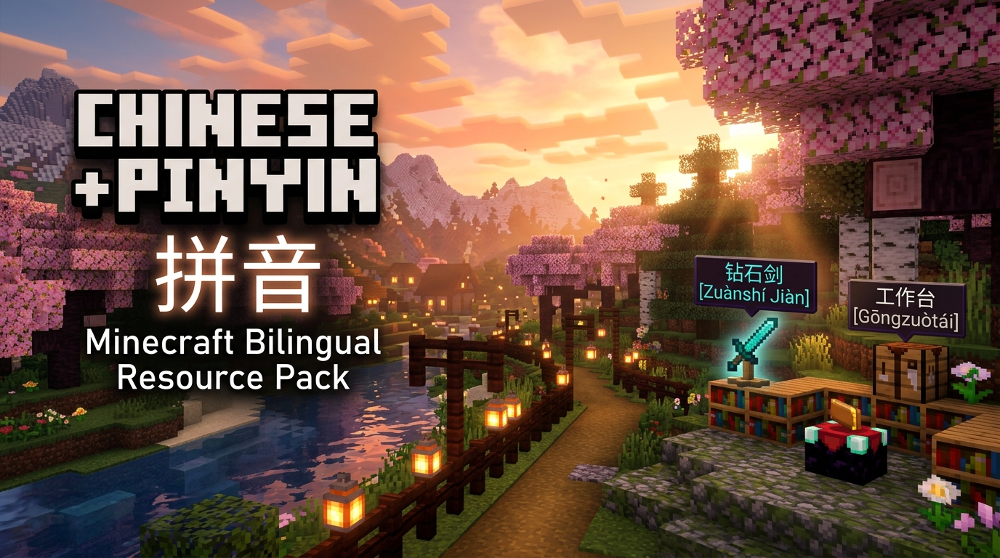

# Minecraft Chinese with Pinyin (拼音) Resource Pack

[](https://github.com/MatthewShkolnik/Minecraft-Chinese-Pinyin-Resource-Pack/releases)
[](https://minecraft.net)
[](https://minecraft.wiki/w/Pack_format)
[](https://github.com/MatthewShkolnik/Minecraft-Chinese-Pinyin-Resource-Pack/actions)
[](LICENSE)
[](generate_pack.py)

<p align="center">
  
</p>

A Minecraft resource pack (for both **Java Edition** and **Bedrock Edition**) that displays Chinese characters (Hanzi) alongside tone-marked Pinyin, Zhuyin (Bopomofo), or Cantonese Jyutping for items, blocks, mobs, and UI elements, while keeping all in-game slash commands and parser feedback in standard English.

---

## Features

* **Dual Hanzi and Phonetic Annotations**: Every in-game item, block, mob, and menu string is annotated with pronunciation and tone marks using Chinese NLP tokenization (`jieba` + `pypinyin`).
* **Minecraft Bedrock Edition Export (`.mcpack`)**: Generates ready-to-install Bedrock resource packs with custom `manifest.json`, `pack_icon.png`, and official vanilla `.lang` translations from Mojang's bedrock-samples repository.
* **Muted Pinyin Styling (`§7` Gray)**: Pronunciation annotations appear in clean subtle gray `§7(...)§r` so Chinese characters remain visually dominant and easy to read.
* **Regional Phonetic Guides**:
  * **Mandarin Pinyin (`zh_py`)**: Standard Pinyin with tone marks.
  * **Taiwan Zhuyin / Bopomofo (`zh_zy`)**: Dedicated custom language **中文 (注音)** with Bopomofo annotations (e.g. `鑽石劍 §7(ㄗㄨㄢ ㄕˊ ㄐㄧㄢˋ)§r`).
  * **Cantonese Jyutping (`zh_yue`)**: Dedicated custom language **廣東話 (粵拼)** with LSHK Jyutping annotations (e.g. `鑽石劍 §7(zyun3 sek6 gim3)§r`).
* **Learning Modes & Multi-Variants**:
  * **Standard Tone Marks**: `钻石剑 §7(Zuànshí Jiàn)§r`
  * **Tone Numbers (`--pinyin-style numbers`)**: `钻石剑 §7(Zuan4shi2 Jian4)§r`
  * **Character Recall Mode (`--recall`)**: Inverts display order to test character recognition: `Zuànshí Jiàn §7(钻石剑)§r`
* **Broad CJK Unicode Coverage**: Supports standard BMP Hanzi as well as CJK Extension A, compatibility, and supplementary plane characters (e.g. `䃮` cobblestone, `㭜` acacia, `䦪` creaking, `𥹉`).
* **Domain Polyphone Overrides (`data/pinyin_overrides.json`)**: Fine-tuned pronunciation for Minecraft-specific terminology (e.g. `重锤` -> `Zhòngchuí`, `藏宝图` -> `Cángbǎotú`, `附魔` -> `Fùmó`, `嘎枝` -> `Gāzhī`, `粘性活塞` -> `Niánxìng Huósāi`).
* **100% English Commands Preserved**: All command syntax, arguments, error parsing strings, and command feedback (`/give`, `/teleport`, `/locate`, `/gamerule`, argument helpers, SNBT parsing) remain in standard English to maintain muscle memory and autocomplete functionality across both Java and Bedrock editions.
* **Multi-Version Compatibility**: Includes `supported_formats` (`min_inclusive: 32, max_inclusive: 97+`) to eliminate red "Incompatible pack" warnings across 1.20.5 through 1.21.4+ and newer releases.
* **Fast Automated Asset Generation**: Includes a cached Python generator that queries Mojang's official `piston-meta` API with local caching and CLI flags.

---

## Use Cases

* **Language Learning**: Learn vocabulary and character pronunciation through in-game context without relying on standalone flashcards.
* **Multiplayer and International Servers**: Navigate Chinese-language Minecraft servers, inventories, trade menus, and chat references without translation friction.
* **Heritage Speakers**: Bridge existing conversational spoken Mandarin with character recognition using Pinyin phonetic guides.
* **Server Administration**: Maintain and execute command blocks, macros, and server commands without broken syntax or localized command arguments.
* **Bilingual Content Creation**: Produce dual-language content accessible to both English- and Chinese-speaking audiences.

---

## In-Game Examples

| Item / Concept | Standard English | Vanilla Chinese | Pinyin Resource Pack |
| :--- | :--- | :--- | :--- |
| Diamond Sword | Diamond Sword | 钻石剑 | `钻石剑 (Zuànshí Jiàn)` |
| Mace | Mace | 重锤 | `重锤 (Zhòngchuí)` |
| Creeper | Creeper | 苦力怕 | `苦力怕 (Kǔlì Pà)` |
| Crafting Table | Crafting Table | 工作台 | `工作台 (Gōngzuòtái)` |
| Golden Apple | Golden Apple | 金苹果 | `金苹果 (Jīnpíngguǒ)` |
| Buried Treasure Map | Buried Treasure Map | 藏宝图 | `藏宝图 (Cángbǎotú)` |
| Ender Dragon | Ender Dragon | 末影龙 | `末影龙 (Mòyǐnglóng)` |
| Cobblestone (Classical) | Cobblestone | 䃮 | `䃮 (Tán)` |
| Commands | `/gamerule keepInventory true` | `游戏规则...` | `/gamerule keepInventory true` (English) |

---

## Installation

### Java Edition
1. Download `Minecraft-Chinese-Pinyin-v1.2.1.zip` (or Numbers / Recall variants) from [Releases](https://github.com/MatthewShkolnik/Minecraft-Chinese-Pinyin-Resource-Pack/releases).
2. In Minecraft: Java Edition, go to **Options** -> **Resource Packs...** -> **Open Pack Folder**.
3. Copy the `.zip` file into the opened `resourcepacks` directory.
4. Move the pack from the **Available** column to the **Selected** column, then click **Done**.
5. Under **Options** -> **Language...**, select:
   * **中文 (拼音)** for Mandarin Pinyin
   * **中文 (注音)** for Taiwan Bopomofo
   * **廣東話 (粵拼)** for Hong Kong Cantonese Jyutping
   * Or any standard Chinese dialect or English (US).

### Bedrock Edition
1. Download `Minecraft-Chinese-Pinyin-v1.2.1.mcpack` from [Releases](https://github.com/MatthewShkolnik/Minecraft-Chinese-Pinyin-Resource-Pack/releases).
2. Double-click or open the `.mcpack` file on Windows, Android, iOS, or iPadOS to import directly into Minecraft.
3. In Minecraft: Bedrock Edition, navigate to **Settings** -> **Global Resources**, select the pack, and click **Activate**.

---

## Building from Source

To generate the resource pack from scratch or build all variants:

### 1. Prerequisites
Python 3.9 or newer is required.

### 2. Install Dependencies
```bash
pip install -r requirements.txt
```

### 3. Run Generator
```bash
# Build standard Java pack
python generate_pack.py

# Build all variants (Standard, Numbers, Recall, and Bedrock .mcpack)
python generate_pack.py --all-variants

# Build Bedrock Edition (.mcpack) only
python generate_pack.py --bedrock

# Build Tone Numbers variant
python generate_pack.py --pinyin-style numbers

# Build Character Recall variant
python generate_pack.py --recall
```

### 4. Configuration (`.config`)

You can customize the Pinyin annotation color and defaults directly in the [`.config`](.config) file without passing command-line flags every time:

```ini
# .config
pinyin_color = §7      # Formatting code (§7, §6), color name (gray, gold, yellow), or 'none'
pinyin_style = marks   # marks, numbers, plain, bopomofo, jyutping
recall = false         # true or false
```

Supported color formats:
* **Minecraft formatting codes**: `§7` (muted gray), `§6` (gold), `§e` (yellow), `§a` (green), `§b` (aqua), `§c` (red), `§d` (pink), `§f` (white), etc.
* **Digit/hex codes**: `7`, `6`, `e`, `a`, `b`, `c`, `d`, `f`
* **Color names**: `gray`, `gold`, `yellow`, `green`, `aqua`, `red`, `light_purple`, `white`
* **Plain / unstyled text**: `none`, `off`, `false`

### 5. Run Automated Test Suite
```bash
python -m unittest discover -s tests -v
```

---

## Repository Structure

```text
Minecraft-Chinese-Pinyin-Resource-Pack/
├── .config                             # Generator configuration file (color, style, recall)
├── .github/
│   └── workflows/
│       ├── ci.yml                      # Automated CI workflow (Python 3.9-3.13)
│       └── release.yml                 # Automated multi-variant release workflow
├── curseforge/                         # CurseForge release graphics
│   ├── curseforge_logo.png             # 1024x1024 project avatar
│   ├── curseforge_banner.png           # 1376x768 (16:9) banner
│   └── curseforge_banner_wide.png      # 1376x458 (3:1) header banner
├── data/
│   ├── pinyin_overrides.json           # Domain polyphone & CJK extension overrides
│   └── cantonese_dict.json             # LSHK Cantonese Jyutping dictionary
├── dist/                               # Generated unpacked packs and archives
│   ├── Pinyin_Resource_Pack/           # Java pack (zh_cn, zh_hk, zh_tw, lzh, zh_py, zh_zy, zh_yue)
│   ├── Pinyin_Bedrock_Pack/            # Bedrock pack (manifest.json, texts/)
│   ├── Minecraft-Chinese-Pinyin-v1.2.1.zip
│   ├── Minecraft-Chinese-Pinyin-v1.2.1-Numbers.zip
│   ├── Minecraft-Chinese-Pinyin-v1.2.1-Recall.zip
│   └── Minecraft-Chinese-Pinyin-v1.2.1.mcpack
├── release/                            # Distribution release assets
│   ├── RELEASE_NOTES.md
│   └── SHA256SUMS.txt
├── tests/
│   └── test_pack.py                    # Automated test suite (20 unit tests)
├── banner.png                          # Repository banner
├── generate_pack.py                    # Pack generator script
├── pack.png                            # Pack icon (256x256)
├── requirements.txt                    # Python dependencies
├── LICENSE                             # MIT License
└── README.md                           # Documentation
```

---

## Contributing

Feedback, bug reports, and pull requests are welcome:
* **Polyphonic corrections (多音字)**: Submit updates directly to [`data/pinyin_overrides.json`](data/pinyin_overrides.json).
* **New Minecraft versions**: Test compatibility with new snapshots or drops.
* Submit issues and pull requests via the [GitHub Issues](https://github.com/MatthewShkolnik/Minecraft-Chinese-Pinyin-Resource-Pack/issues) page.

---

## License

Distributed under the [MIT License](LICENSE).

Minecraft is a registered trademark of Mojang AB / Microsoft. This project is an independent community resource pack and is not affiliated with Mojang or Microsoft.
